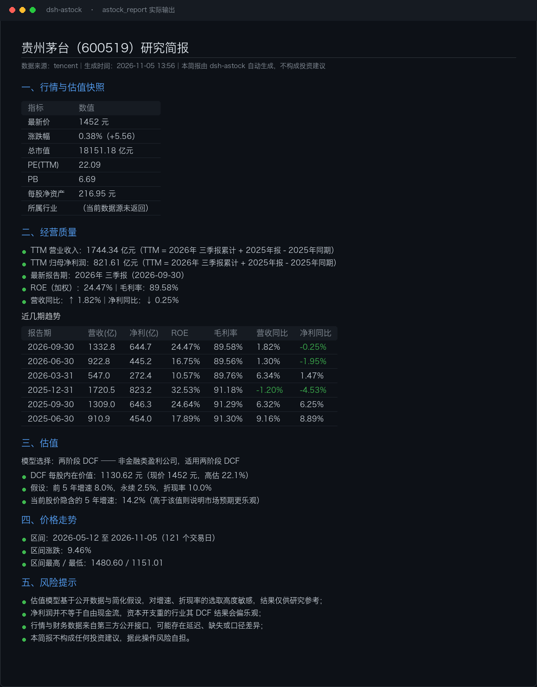

# dsh-astock · A 股研究台

> 给 DeepSeek Harness 装上一整套 A 股研究能力：查行情、读财报、算估值、出研报。**零配置、免 API Key、装完即用。**



<!-- TODO(screenshot): 发布前放一张真实的研报输出截图，这是转化率最高的位置。 -->

## 为什么做这个

现有的 DSH 股票类插件基本停在「盯盘」这一层：悬浮窗看涨跌、行情条、K 线卡片。但它们回答不了研究者真正要问的问题——

- 这家公司**赚钱质量**怎么样？ROE、毛利率、增速在往哪走？
- 现在这个价格，**隐含了市场多少增长预期**？
- 它是**高估还是低估**？为什么？

`dsh-astock` 把这些做成了模型可以直接调用的工具，而不是让你自己在对话里贴数据。它不只是取数，还**内置了估值模型**：非金融公司走两阶段 DCF，银行/保险/证券自动切换到 PB-ROE——因为用 DCF 算银行得到的安全边际是没有意义的。

## 快速开始

```bash
# 安装到某个 profile（未指定则用默认 profile）
dsh plugin add dsh-astock

# 确认插件层已加载
dsh --profile default --dump-config | grep dsh-astock
```

本地开发时可以直接链接源码目录：

```bash
git clone https://github.com/WilShi/dsh-astock.git
cd dsh-astock && pnpm install && pnpm build
dsh plugin --profile demo add ./dsh-astock
```

> 从 git 直接安装（`dsh plugin add github:WilShi/dsh-astock`）需要 pnpm 允许运行 `prepare` 构建脚本，pkg 会提示你往 `pnpm-workspace.yaml` 加 `allowBuilds`。推荐直接发 npm 或用 `pnpm pack` 出的 tgz。

装完不需要填任何 token——数据源全是公开接口。

## 六个工具

| 工具 | 作用 | 典型问法 |
| --- | --- | --- |
| `astock_search` | 按代码/名称/拼音检索标的 | 「帮我看看宁德时代」 |
| `astock_quote` | 实时行情 + 市值 + PE/PB + 行业概念 | 「茅台现在多少倍 PE」 |
| `astock_kline` | 前复权日 K 线，判断趋势与区间 | 「最近三个月走势怎么样」 |
| `astock_financials` | 财报摘要 + **TTM 折算** | 「它最近几个季度增长如何」 |
| `astock_valuation` | 自动选模型做估值，给出内在价值与隐含增速 | 「现在这个价格贵不贵」 |
| `astock_report` | 生成完整 Markdown 研究简报 | 「给我出一份茅台的研究简报」 |

### 一次真实对话

```
你：茅台现在贵吗？帮我算一下。

（模型调用 astock_quote + astock_financials + astock_valuation）

贵州茅台（600519）现价 1452 元，模型：dcf
内在价值 1130.62 元，高估 28.4%
当前股价隐含 5 年增速 14.2%
两阶段 DCF：前 5 年按 8.0% 增长，之后永续 2.5%，折现率 10.0%；以净利润近似所有者收益
```

## 估值模型是怎么选的

这是本项目最在意的一点：**不同生意不能用同一个模型。**

| 公司类型 | 模型 | 原因 |
| --- | --- | --- |
| 一般盈利公司 | 两阶段 DCF | 净利润可近似所有者收益 |
| 银行 / 保险 / 证券 | PB-ROE（Justified PB） | 金融企业净利被存款与拨备主导，**不等于自由现金流**，DCF 会算出荒谬的安全边际 |
| 亏损公司 | 不适用 | DCF/PE 都失真，应改用 PS 或重置成本 |

PB-ROE 用的是 Gordon 增长形式：`合理 PB = (ROE - g) / (r - g)`。

TTM（滚动十二个月）也不是直接取最近一期——A 股财报是累计口径，Q3 是三季度累计，所以 TTM 按 `最新累计 + 上年年报 - 上年同期` 折算，并在输出里写明计算依据。

## 数据源与稳定性

所有数据来自公开接口，**不需要任何 API Key**：

| 能力 | 主源 | 备用 |
| --- | --- | --- |
| 行情/估值 | 东方财富 | 腾讯 → 新浪 |
| 日 K 线 | 东方财富 | 腾讯 |
| 财报 | 东方财富 datacenter | — |
| 检索 | 东方财富 searchapi | — |

**为什么要做多源降级**：这些接口都没有文档、也不承诺 SLA。开发期间实测过东方财富的 `push2` 行情接口在请求变多后直接断开连接（所有分片同时不可用），但 `datacenter` 与腾讯、新浪仍然正常。如果只绑定一个源，插件会在你不知情的时候静默失效。所以每次调用按顺序尝试，返回结果里用 `source` 字段告诉你这次是谁答的。

行业与概念标签只有东方财富提供；当行情降级到备用源时，这些字段会是空的，简报里会如实标注。

## 配置

插件本身零配置。估值工具接受可选参数覆盖默认假设：

| 参数 | 默认 | 含义 |
| --- | --- | --- |
| `growthRate` | 0.08 | DCF 显式预测期增速 |
| `terminalGrowth` | 0.025 | 永续增速 |
| `discountRate` | 0.10 | 折现率 / 要求回报率 |
| `years` | 5 | 显式预测年数 |

对话里直接说「按 12% 折现率算」模型就会传对应参数。

## 项目结构

```
.
├── src/
│   ├── index.ts              # 插件入口：注册工具到 ctx.tools
│   ├── tools.ts              # 六个 defineTool 定义
│   ├── datasource/
│   │   ├── index.ts          # 多源降级编排
│   │   ├── eastmoney.ts      # 东财：行情 / K线 / 财报 / 检索
│   │   ├── tencent.ts        # 腾讯：行情 / K线
│   │   ├── sina.ts           # 新浪：行情兜底
│   │   └── types.ts          # 共享类型与 HTTP 工具
│   └── analysis/
│       ├── valuation.ts      # DCF / PB-ROE / TTM / 隐含增速
│       └── report.ts         # Markdown 研报生成
├── cordis.patch.yml          # 插件层声明
└── package.json              # dsh.bundle 声明
```

## 免责声明

本项目是**研究辅助工具**，不构成投资建议。

- 估值结果对增速、折现率假设高度敏感，换个参数结论可能反转；
- 净利润不等于自由现金流，资本开支重的行业 DCF 结果会偏乐观；
- 数据来自第三方公开接口，可能延迟、缺失或口径不一致；
- 据此操作，风险自担。

## License

[MIT](LICENSE) © 2026 WilShi
